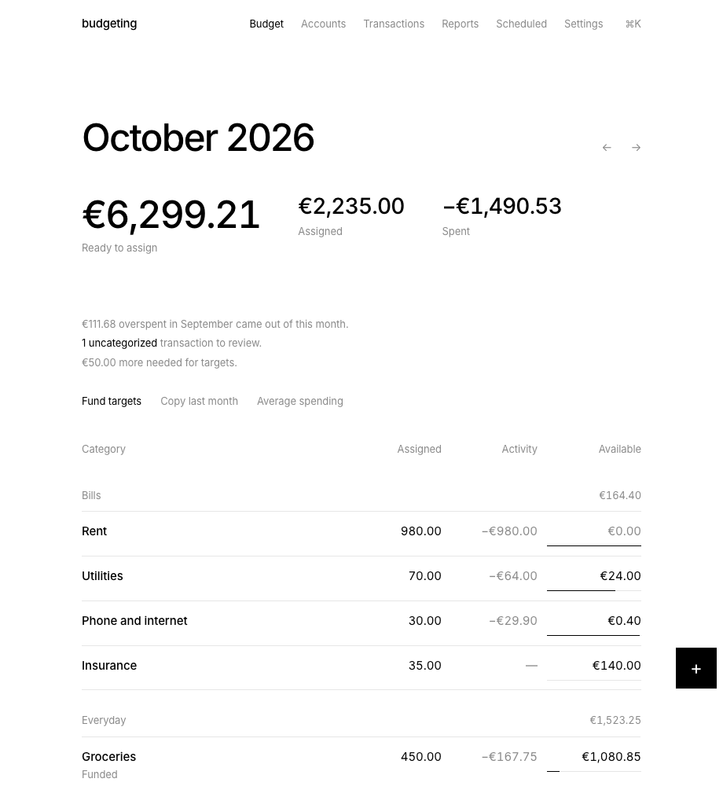

# budgeting

A private personal finance app: envelope budgeting, expense tracking, multi-currency accounts and reports, in one quiet black-on-white interface.

**Live:** https://budgeting.knhdixh.com (private, single Google account)



## Features

| | |
|---|---|
| **Envelope budget** | Every euro gets a job, as in YNAB and Actual Budget. Assign money to categories each month; leftovers roll over; overspending comes out of next month's *ready to assign*. Move money between categories, fund targets in one click, copy last month or assign average spending. |
| **Targets** | Monthly amounts or a total by a date. The budget shows what's still needed. |
| **Accounts** | Checking, savings, cash, credit cards, loans and investments. Budget accounts feed the envelopes; tracking accounts only count toward net worth. Running balances, cleared balance, and reconciliation with automatic adjustments. |
| **Transactions** | Payees with learned categories (rules), splits across categories, transfers (also between currencies), tags, memos, cleared state. Search by payee, memo, category or amount; bulk categorize, clear or delete. |
| **Multi-currency** | Each account has its own currency. Budgets and reports convert to the base currency (EUR) with the ECB's daily reference rates, or a manual rate for currencies the ECB doesn't publish. |
| **Scheduled** | Rent, salary and subscriptions repeat daily, weekly, monthly or yearly, and can post themselves on the day. |
| **Reports** | Spending by category and payee, income vs spending and savings rate, net worth over 12 months. |
| **Import / export** | CSV import with column mapping and duplicate detection (re-importing a file skips rows already there). Full JSON export and a transactions CSV. |
| **Fast to drive** | ⌘K command bar, `N` new transaction, `/` search, `G` then `B`/`A`/`T`/`R`/`S` to switch views, ⌘↵ to save. |
| **PWA** | Installable on desktop and phone, with a bottom tab bar and bottom sheets on small screens. Only the app shell is cached; financial data never goes into the service worker cache. |

## How it works

One Cloudflare Worker serves both the React app (static assets) and a JSON API (`/api/*`, Hono). Data lives in Cloudflare D1 (SQLite).

- **Money** is stored as integer cents. Every transaction also stores its amount in the base currency at that day's rate, so budget maths never needs live rates.
- **Budget maths** lives in a pure module, [`shared/budget.ts`](shared/budget.ts), with unit tests. *Ready to assign* is income through the month, minus everything assigned, minus overspending from earlier months. Uncategorized money counts as income, so ready to assign plus all category balances always equals cash in budget accounts.
- **Sign-in** is Google OAuth (authorization code + PKCE, using [arctic](https://arcticjs.dev)). Only emails listed in `ALLOWED_EMAILS` get in, and only when Google says the email is verified. The first sign-in pins the Google account ID. Sessions are random tokens in an HttpOnly cookie; D1 stores only their SHA-256.
- **Hardening:** writes are refused unless the `Origin` matches; strict CSP, HSTS and `frame-ancestors 'none'`; `*.workers.dev` redirects to the canonical host.
- **Daily cron** (04:15 UTC) refreshes exchange rates and posts due scheduled transactions.
- **Backups:** D1 Time Travel gives point-in-time restore for 7 days. A GitHub Action in a separate private repo exports the database as SQL every night and commits it, which keeps a full version history.

## Stack

TypeScript · React 19 · React Router · TanStack Query · Vite + `@cloudflare/vite-plugin` · vite-plugin-pwa · Hono · Drizzle ORM · Zod · Cloudflare Workers + D1 · cmdk · Recharts · Papa Parse · Vitest

## Run locally

```bash
npm install
cp .dev.vars.example .dev.vars       # DEV_LOGIN=1 enables /auth/dev locally
npm run dev                          # http://localhost:8787, open /auth/dev to sign in
node scripts/seed-demo.mjs           # optional demo data
npm test                             # unit + API tests (in-memory D1 over node:sqlite)
```

## Deploy your own

1. `npx wrangler d1 create budgeting` and put the id in `wrangler.jsonc`. Set `CANONICAL_HOST` and change or remove `routes` for your own domain.
2. Create a Google OAuth client (Web application) with redirect URI `https://<host>/auth/google/callback`.
3. Set the secrets `ALLOWED_EMAILS` (comma-separated), `GOOGLE_CLIENT_ID` and `GOOGLE_CLIENT_SECRET` with `npx wrangler secret put <NAME>`.
4. `npm run deploy` applies migrations, builds and deploys.

This app auto-deploys from `main` via Workers Builds.

## Limitations

- Built for one person; there's no sharing or multi-user budgets.
- No bank syncing. Import CSVs from your bank instead.
- Credit cards are budget accounts with no separate payment category: spending is budgeted when it happens, and card payments are transfers.
- Currencies outside the ECB list need a manual rate, which is then used for all dates.
- The base currency can only be changed before the first transaction.
